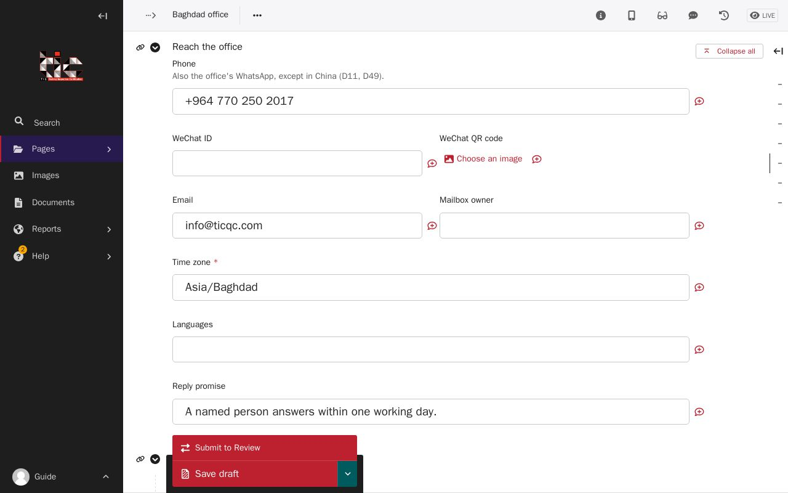
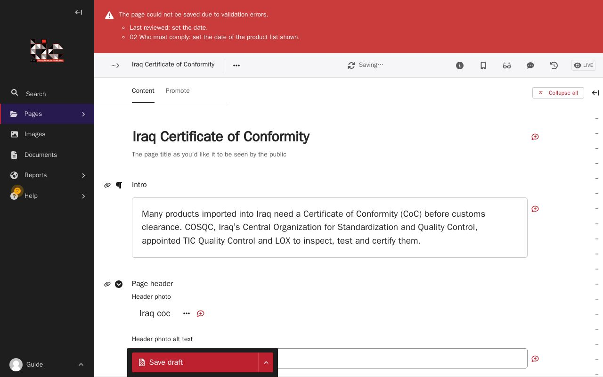
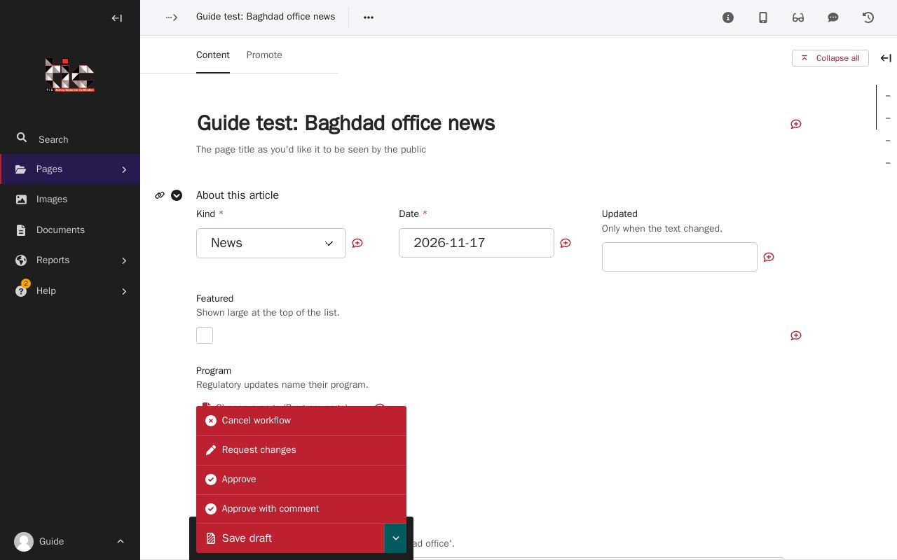
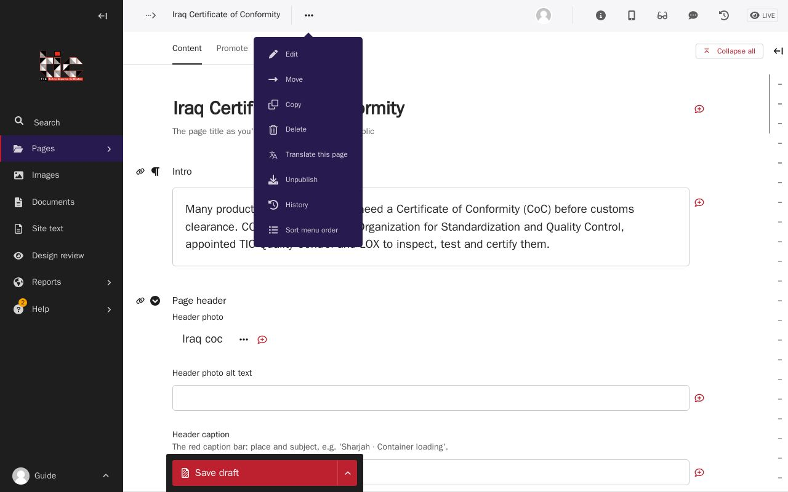
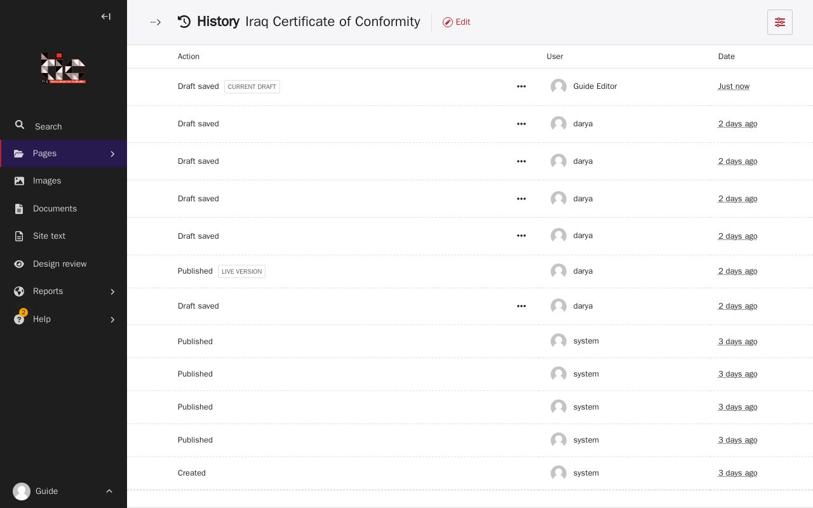

# 2. Draft, review, publish

[← Admin guide](README.md)

A change goes through three states:

1. **Draft**: only people in the admin see it.
2. **In review**: a reviewer checks it.
3. **Live**: the public sees it.

The public page does not change until the draft is approved.

## Save draft and autosave

- Click **Save draft** to keep your work. You can close the page and come back.
- The admin also saves by itself while you type. The top bar shows "Saving…".
- "Save draft" always works, also when a required part is missing.

## Submit to Review

1. Click the arrow next to **Save draft**.
2. Click **Submit to Review**.

The admin now checks the publish rules of the page type
([page 3](03-publish-rules.md)). If a rule is broken, the page is not sent. A red box at
the top lists what to fix:

Fix each line, then click **Submit to Review** again.

Which reviewer gets the page:

| Page | Workflow | Who approves |
| --- | --- | --- |
| News item | Light | The reviewer of the office chosen in **Office**, or a content manager |
| Office page, program page | Review | The reviewer of that office, or a content manager |
| All other pages | Review | A content manager |

## Approve or request changes (reviewers)

1. On the dashboard, **Awaiting your review** lists the pages.
2. Click the page. Read the change. To see what changed, open **History** (the clock
   icon, top right) and click **Compare**.
3. Click the arrow next to **Save draft**. Choose:
   - **Approve**: the page goes live.
   - **Approve with comment**: the same, with a note to the editor.
   - **Request changes**: the page goes back to the editor with your note.
   - **Cancel workflow**: stop the review. The draft stays.

Rules:

- You cannot approve a page that you submitted.
- If you change the page during the review, the review starts again. Another reviewer
  must approve it.

## History and undo

1. Open the page.
2. Click **•••** next to the title, then **History**.

3. Each line is one saved version, with the person and the time.
4. To go back to an old version, click **•••** on its line, then **Review this
   version**, then **Replace current draft**. Then submit it as usual.

## Schedule a page

1. Open the page. Click the **i** icon (top right). The status panel opens. Click
   **Set schedule**.
2. Set **Go-live date/time**. You can also set **Expiry date/time**.
3. Submit the page as usual. It goes live at that time after approval.

## Unpublish or delete

Office editors cannot unpublish or delete. Ask your office reviewer or a content
manager. A deleted page cannot come back.
