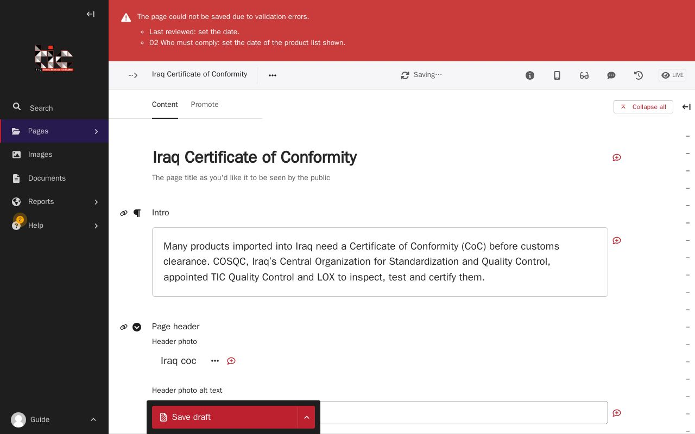

# 3. Publish rules of each page type

[← Admin guide](README.md)

Some page types have rules. The admin checks them when you click **Submit to Review** or
**Publish**. **Save draft** never checks them. If a rule is broken, a red box at the top
lists each problem, and the field shows the same message.

Why the rules exist: a visitor must find all the facts on a page, and TIC must never show
a fact it cannot prove.

## Program page (for example, Iraq Certificate of Conformity)

A program page has twelve parts, in order 01 to 12, and all twelve are needed.

| Message | What to do |
| --- | --- |
| Intro: write the one sentence under the title. | Write **Intro**. |
| Regulator: give its name and its abbreviation. | Fill **Regulator** and **Regulator abbreviation** (for example COSQC). |
| Appointment: choose the regulator's status word. | Choose the **Status word**. |
| Owning office: choose the office that owns this page. | Under **Ownership and review**, choose the office page. |
| Last reviewed: set the date. | Under **Ownership and review**, set **Last reviewed** (usually today). |
| Review by: set the date this page is checked again. | Set **Review by** ([page 5](05-review-by.md)). |
| Add the missing parts: 03, 07. | Click **+** and add the parts with these numbers. |
| Put the parts in their fixed order, 01 to 12. | Move the parts with the up and down arrows. |
| 01 The regulator and our appointment: write the text. | Write the text of part 01. |
| 02 Who must comply: add at least one product group. | Add a row to the **product table**. |
| 02 Who must comply: set the date of the product list shown. | Set the **version date** under the product table. |
| 03 Routes: add at least one question with its answers. | Add a question and its answers. |
| 04 Step by step: add at least one step with a title and a text. | Add a step. |
| 05 Document checklist: add at least one document. | Add a document line. |
| 05 Document checklist: name the request form. | Fill the request form name. |
| 06 Testing, inspection and labelling: add at least one point. | Add a point. |
| 07 Fees: choose how fees are shown, then fill the table or choose the fee structure document. | Choose table, document or "on request", then fill it. |
| 08 Questions and answers: add at least one question with its answer. | Add a question and its answer. |
| 10 Contacts: add at least one office with its role. | Add an office and its role. |
| 12 Last reviewed: write the disclaimer. | Write the disclaimer of part 12. |
| Appointment: a regulator appoints or registers TIC. Use the regulator's own word, not 'accredited'. | Remove "accredited" from the intro, the summary and part 01. |

## Service page

A service page has eleven parts, in order 01 to 11, and all eleven are needed.

| Message | What to do |
| --- | --- |
| Intro: write the one sentence under the title. | Write **Intro**. |
| Add the missing parts: … / Put the parts in their fixed order, 01 to 11. | As for programs. |
| What it is: write a heading and the text. | Fill both. |
| Who needs it: add at least one case. | Add a line. |
| How it works: add at least one step with a title and a text. | Add a step. |
| What you give us: add at least one document. | Add a line. |
| What you get: say what the report or certificate contains. | Add a line. |
| Standards we work to: add at least one standard by number. | Add a standard with its number. |
| Where we do it: name the offices or write where. | Choose offices or write a text. |
| Related services: choose at least one page. | Choose a page. |
| Questions and answers: add at least one question with its answer. | Add one. |
| Contact: choose the named contact. | Choose a person. |
| Contact: name the request form. | Fill the request form name. |
| Last reviewed: set the date and the owning office. | Fill both in the last part. |
| Testing pages name the partner laboratory: choose it under 'Partner laboratory'. | For a testing service, choose the laboratory. |

## Office page

The admin refuses to save an office page without these, also as a draft:

| Message | What to do |
| --- | --- |
| The address is required. | Write the address. |
| A phone number or an email address is required. | Give at least one. |
| Use a time zone name such as 'Asia/Baghdad'. | Write the time zone name exactly, for example `Asia/Dubai`. |

## Policy page (Impartiality, Privacy, Terms, …)

Message at each field: **Needed to publish a policy page.** Fill **Document code**,
**Issue and revision**, **Effective date** and the document owner. They come from the signed policy
document. Do not invent them: ask the Quality Manager.

## Course page

Message at each field: **Needed to publish a course.** Fill **Price**, **Dates**,
**What the certificate says** and **Certificate issued by**. Until the training team gives them, the
course stays a draft.

## Downloads library row and accreditation row (snippets)

| Message | What to do |
| --- | --- |
| Choose a file or give a link. | A download row needs a document or a link. |
| Use en, ar or zh, comma separated. | Write the languages as codes, for example `en, ar`. |
| A mark needs a register link. | An accreditation logo is shown only with the link to the body's register. |
| A mark needs a row shown on the site. | Show the row before you show its logo. |

## Pages without rules

News, home, about, industries, index pages: only the fields with a red **\*** are needed.
