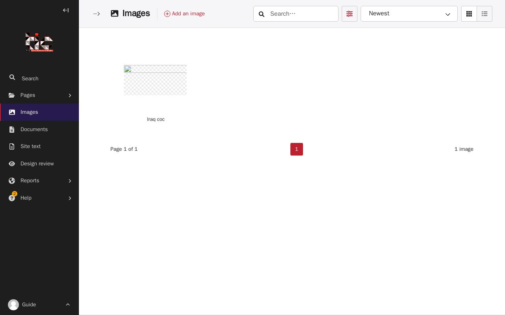
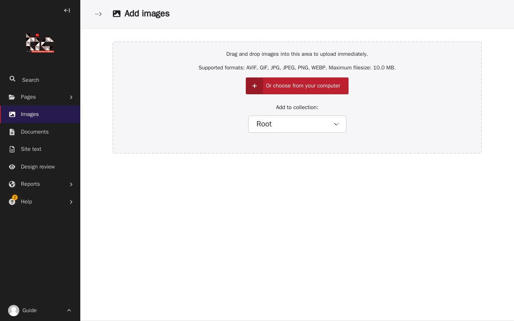
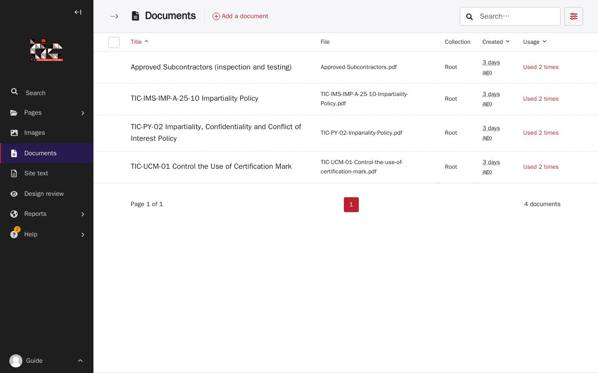

# 4. Images and documents

[← Admin guide](README.md)

Images (photos, maps, QR codes) and documents (PDF files) live in two libraries. A page
does not hold the file. It points to the file in the library.

Each office has its own folder, called a **collection**: `Offices › <City>`. An office
editor uploads into the office's collection.

## Upload an image

1. Click **Images** in the menu. Then click **Add an image**.

2. At **Add to collection**, choose your office.
3. Drag the photos onto the grey area, or click **Or choose from your computer**.

4. For each photo, write the **Title** and the **Description**. The description is the
   alt text: a short sentence that says what the photo shows, for a person who cannot
   see it. Example: "Inspector checks a container seal in Umm Qasr port."
5. Click **Update**.

Rules for photos:

- JPG, PNG or WEBP, up to 10 MB. The website makes the small versions itself.
- Use a wide photo, at least 1600 pixels wide, for a page header.
- No people's faces without their agreement. No customer names or labels you may not show.
- Photos from the old ticqc.com site may be used as they are.

## Put an image in a page

1. Open the page. At the image field (for example **Header photo**), click **Choose an
   image**.
2. Search or click the photo. Click it.
3. If the page has an **alt text** field next to the image, write it there too.
4. Save draft and submit as usual.

## Upload a document

1. Click **Documents**. Then click **Add a document**.

2. Choose the collection, then the file.
3. Write a clear **Title**: the name, the version and the date. Example: "COSQC product
   list, version 2026-10".
4. Click **Upload**.

## Replace a document with a new version

1. Click **Documents**. Click the old document.
2. At **Change document file**, choose the new file. Change the **Title** to the new
   version.
3. Click **Save**. Every page that points to it now shows the new file.

Delete an old version only when no page uses it. The document page shows **Usage**.

## Downloads library

The public **Downloads library** lists rows of the **Downloads** snippet, not the
document library itself. A content manager adds a row: title, type, the document or a
link, the program or service, version, date, owner and languages.
