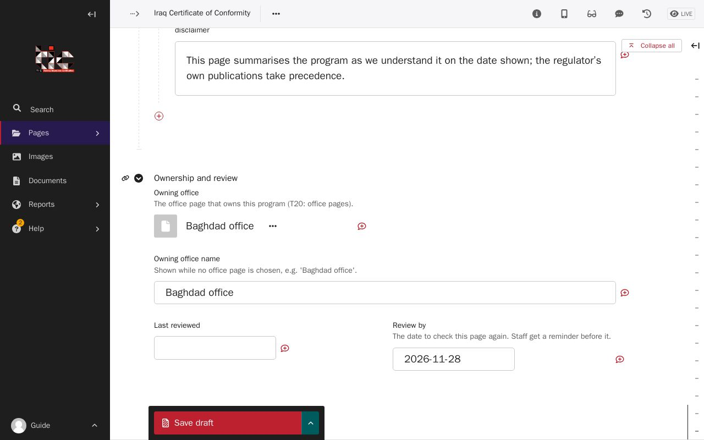
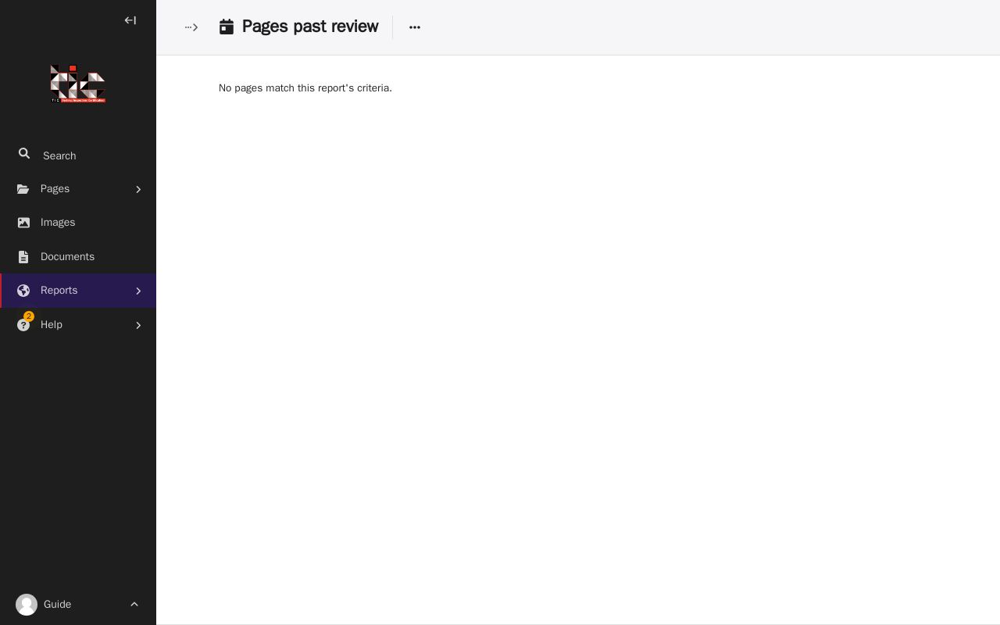

# 5. Review-by dates

[← Admin guide](README.md)

Rules of a program change. So each program page has two dates under **Ownership and
review**:

- **Last reviewed**: the day a person last checked the page against the regulator.
- **Review by**: the day it must be checked again.

## The reminder mail

Every day, the website looks for pages whose **Review by** date is in the next 14 days.
For each one, it sends one mail to the editors and the reviewers of the owning office:

> **Review due: Iraq Certificate of Conformity by 2026-11-28**
>
> This page must be checked again by 2026-11-28:
> Iraq Certificate of Conformity — (link to the public page)
>
> Check the text, update it if needed, and set a new review date: (link to the admin)

The mail comes once for each date. If you change the date, a new mail comes before the new
date.

## What to do

1. Click the admin link in the mail. Log in if asked.
2. Open the regulator's website. Compare: product list, steps, fees, documents.
3. Change what is different. If a product list changed, upload the new list
   ([page 4](04-images-and-documents.md)) and set the new **version date**.
4. Set **Last reviewed** to today.
5. Set **Review by** to the next check. Three months is a good default; one month while
   the regulator is changing the rules.
6. Click **Submit to Review**.

Even when nothing changed, do steps 4 to 6. The page then shows the new "last reviewed"
date to visitors.

## Pages past review

If the date passes, the page is listed in **Reports → Pages past review**. The public page
never shows this. Keep the list empty.

