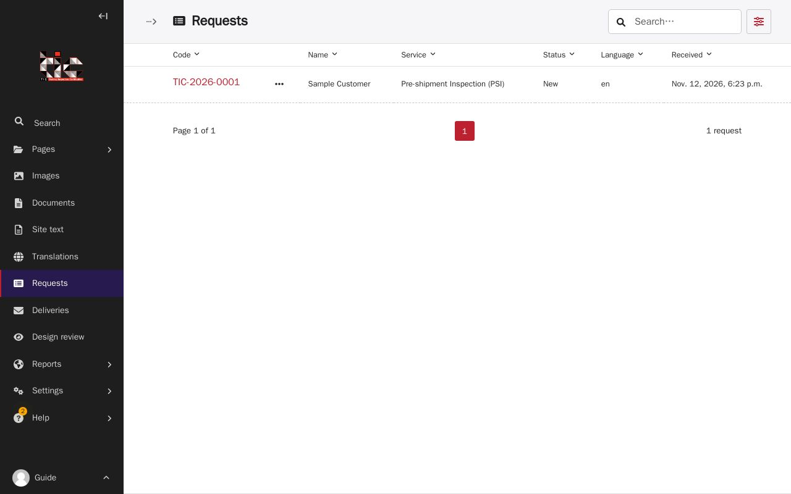
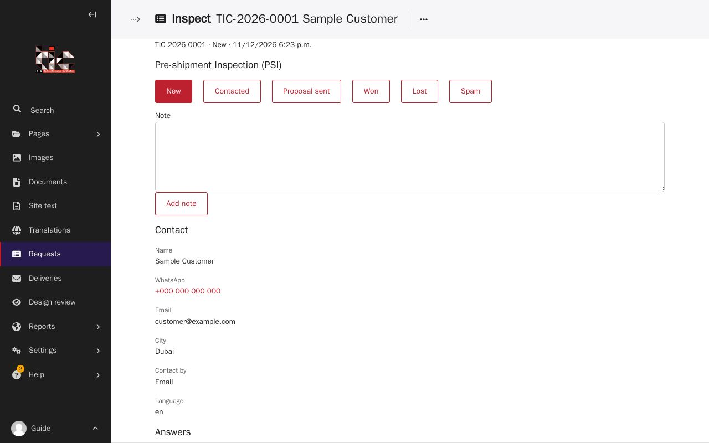

# 6. Requests

[← Admin guide](README.md)

A request is a form sent from the website: a quote, a complaint, a job application, a
course registration. Each one gets a code, for example `TIC-2026-0001`.

When a request arrives:

1. The website stores it in **Requests**.
2. It sends a mail to the address chosen by **Routing** ([page 7](07-users-groups-routing.md)).
3. The customer sees the code on the screen.

Today, site admins open requests in the admin. Office editors will see the requests of
their own office in a later version.

## Read a request

1. Click **Requests** in the menu. The newest is at the top. Use **Search** or the filter
   button to find one.

2. Click the code. The request opens: the status, the contact, the answers and the files.

3. To open a file the customer sent, click its name. Files are private. Only logged-in
   staff can open them.

## Change the status

Click one status button:

| Status | When |
| --- | --- |
| New | Nobody acted yet. |
| Contacted | You answered the customer. |
| Proposal sent | You sent an offer or a quotation. |
| Won | The customer accepted. |
| Lost | The customer said no, or did not answer. |
| Spam | Not a real request. |

## Add a note

1. Write in **Note**: what you did, when, and what comes next.
2. Click **Add note**.

The history keeps every status and every note, with the person and the time. Do not write
in notes what the customer may not see in a legal request for their data.

## Complaints and appeals

A complaint goes to the Quality Manager. Treat it by the TIC complaints procedure. Change
the status and add a note at each step.
