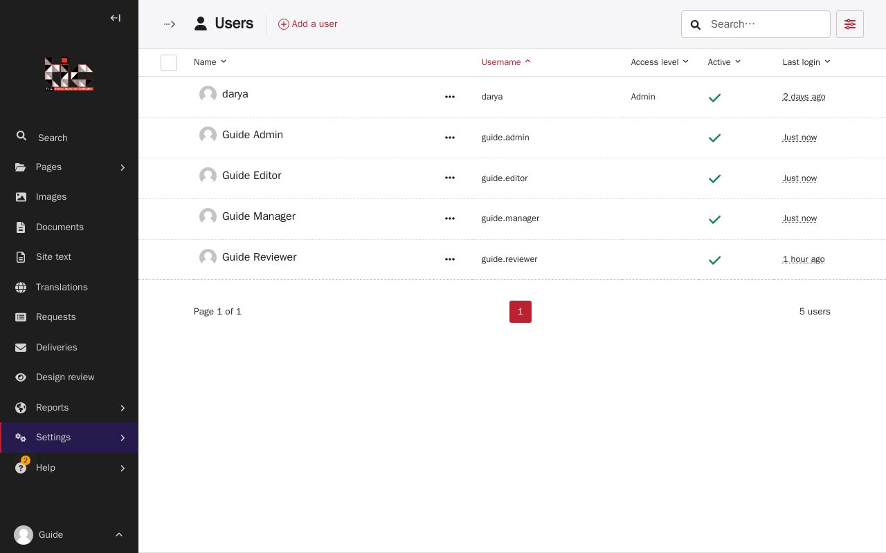
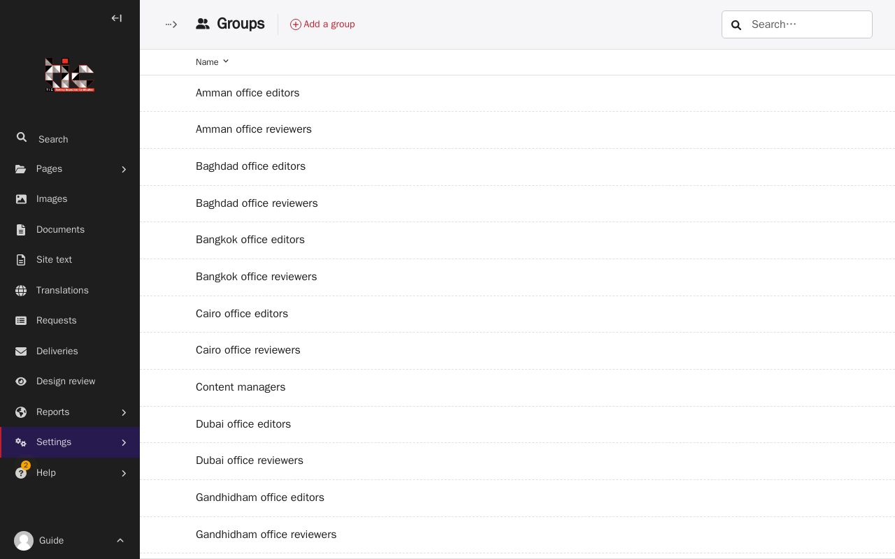
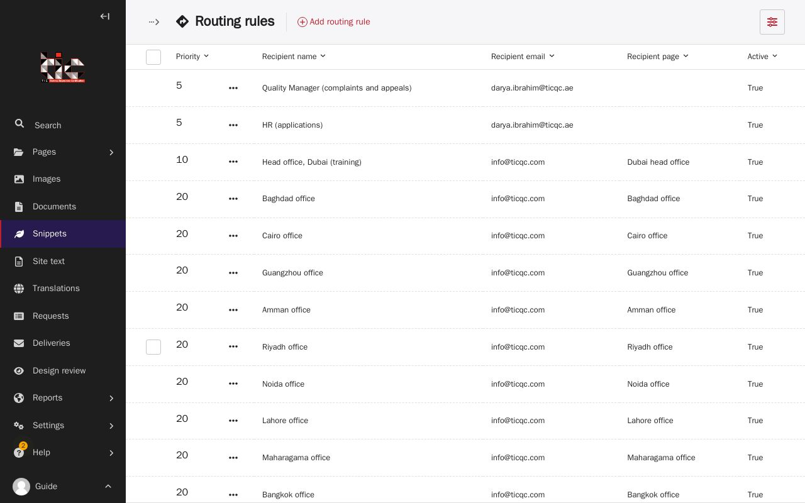
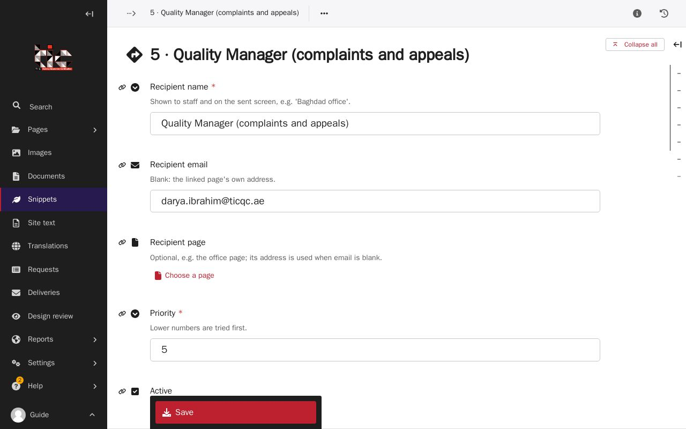

# 7. Users, groups and routing (site admins)

[← Admin guide](README.md)

## Add a person

1. Click **Settings → Users**, then **Add a user**.

2. Write the username (for example `firstname.lastname`), the email, the first and last
   name, and a first password. Click **Roles**.
3. Tick the groups for the person's role (table in the [README](README.md)). An office
   editor gets `<City> office editors`. An office manager who approves gets
   `<City> office reviewers`.
4. Click **Add user**. Send the person the address and ask them to change the password
   under **Account**.

Rules: one person, one account. Never share an account. When a person leaves, open the
user and untick **Active** the same day.

## Groups

**Settings → Groups** lists the groups. Do not change their rights by hand: the website
sets them again at each update. To change a right, ask the developer.

## Add an office

A new office needs a page, two groups and a media collection. The developer runs one
command, `add_office`, which makes all three. Then a content manager fills the office
page.

## Routing: where request mails go

**Routing** rules choose the address of the mail for each new request. Example: a quote
for the Iraq program goes to the Baghdad office; a complaint goes to the Quality Manager.

1. Click **Snippets → Routing rules** (or **Routing** in the menu).

2. Click a rule to change it, or **Add routing rule**.

3. Fill:
   - **Name**: shown to staff and to the customer, for example "Baghdad office".
   - **Email**: the address. Leave it blank to use the email of the chosen page (office).
   - **Page**: optional, for example the office page.
   - **Priority**: lower numbers are tried first.
   - **Active**: untick to stop the rule without deleting it.
   - **Conditions**: all must match the request's answers. No condition: the rule
     matches every request.
4. Click **Save**.

If no rule matches, the mail goes to the site's main contact address. A request is never
lost.

Until the launch, missing addresses use a test address (D55). The launch checklist
replaces them.
