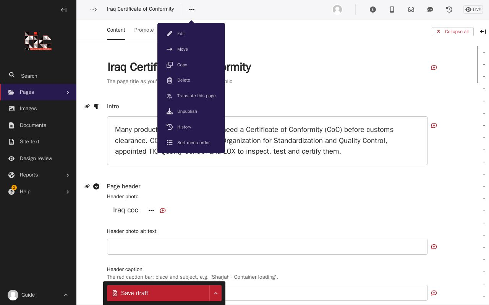
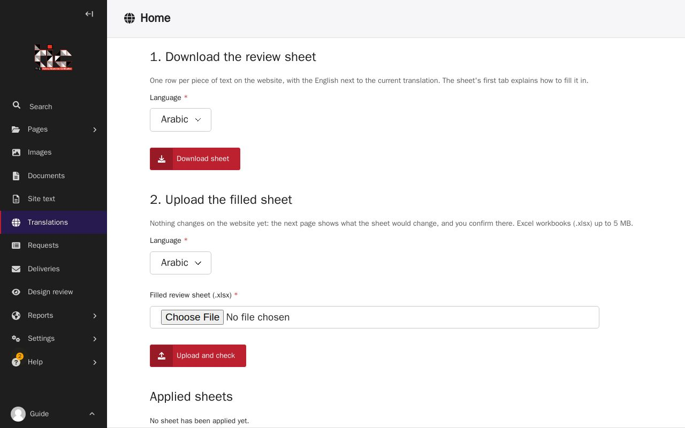

# 8. Translations into Arabic

[← Admin guide](README.md)

The website is in English first. Some pages also have an Arabic version. Arabic is
shown to the public only after a named reviewer signs the translations (master plan 08).

There are two ways to translate.

## A. One page in the admin

1. Open the English page. Click **•••** next to the title, then **Translate this page**.

2. Choose **Arabic**. Click **Submit**.
3. The translation editor opens. Each piece of English text is on the left. Write the
   Arabic on the right, then click the tick to keep it.
4. When every piece is done, click **Publish in Arabic** (or **Save draft**).

When the English page changes later, the Arabic page shows the changed pieces again for
translation.

## B. The review sheet (many pages at once)

The review sheet is an Excel file with every piece of text of the site: the English,
the current Arabic draft, and a column for the approved text.

1. Click **Translations** in the menu.

2. Under **1. Download the review sheet**, choose **Arabic** and click **Download
   sheet**.
3. Open the file. The first tab explains the columns. The reviewer writes the approved
   Arabic in **approved text**, or a note in **reviewer note**.
4. Under **2. Upload the filled sheet**, choose **Arabic**, choose the file, and click
   **Upload and check**.
5. The next page shows what the sheet would change. Nothing changes yet. Read it.
   - A **stale** row: the English changed after the download. Its approval is not used.
   - An **invalid** row: the Arabic drops or adds a link, a tag or a `%(name)s` part.
6. Click **Apply** to load the approved rows, or **Discard**.

An Arabic page goes live only when all its pieces are approved. Otherwise it stays a
draft.

## The first Arabic pages

Sixteen pages already have an Arabic draft: Home, Verify, Our offices and six office
pages (Baghdad, Cairo, Amman, Riyadh, Dubai, Sharjah), About, Accreditations,
Impartiality, Privacy, Complaints, Programs and the Iraq program. The developer wrote the
drafts (file `seed/ar.yaml`). They are drafts until the reviewer approves them. On
staging these drafts are live, so the reviewer can read the pages. Production shows no
Arabic page before the sign-off.

- The reviewer uses **Way 2** (the review sheet). Each row with a draft needs **OK** or
  the corrected Arabic in **approved text**.
- A text you change in the translation editor or in the sheet is kept. The seed does not
  write over it.
- An address, a legal name and a mark (TIC, COSQC, ISO/IEC 17020) stay in Latin letters
  until the office gives the Arabic.

## When Arabic goes live

Arabic pages are hidden from visitors until the reviewer's sign-off is recorded. Then the
developer switches Arabic on (setting `SITE_PUBLIC_LANGUAGES`) and empties the cache.
