# Editor guide

For office managers and office editors of TIC Quality Control. It covers the five jobs of
an office: edit your office page, write a news item, update a program's product list,
act on the review-by reminder, and answer a request. Read it once; it takes about
twenty minutes. The pictures come from the staging site (Baghdad office).

The full admin documentation, with every process and every error message, is in
`docs/admin-guide/` (T35). This guide is its first page.

## Words you will see

| Word | What it means |
| --- | --- |
| Admin | The editing side of the website. Address: `/admin/` on the site. |
| Draft | A change that only editors see. The public site does not change. |
| Submit to Review | Send your draft to a reviewer. You cannot publish it yourself. |
| Reviewer | A person of your office (or a content manager) who checks and publishes. |
| Publish | Put the change on the public site. Only a reviewer or a content manager can. |
| Review by | The date when a page must be checked again. |

Rules:

- One person, one account. Do not share your password.
- Nobody approves their own work. Another person always checks it.
- Write only facts you can show. If a fact is not confirmed, keep it in square
  brackets, for example `[examples]`, and ask the head office.
- Always say "TIC Quality Control", then "TIC". Say "Kurdistan Region of Iraq".

## 1. Log in

1. Open the admin address: on staging, <https://staging.ticqc.ae/admin/>.
2. Type your username and your password.
3. Click **Sign in**.

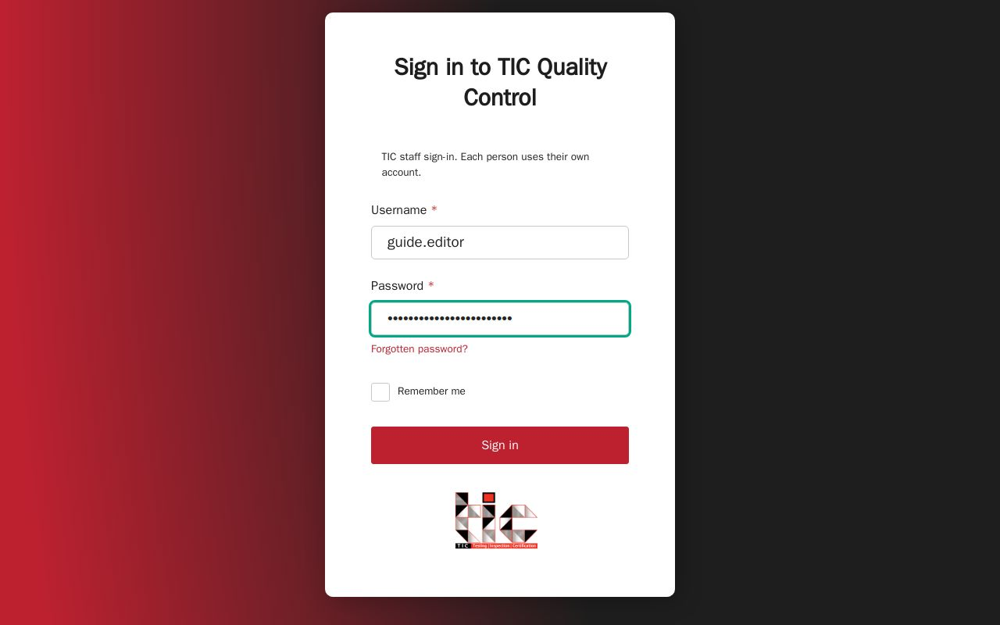

The dashboard opens. The menu on the left has **Pages**, **Images**, **Documents** and
**Reports**. You see only the pages that your office can edit.

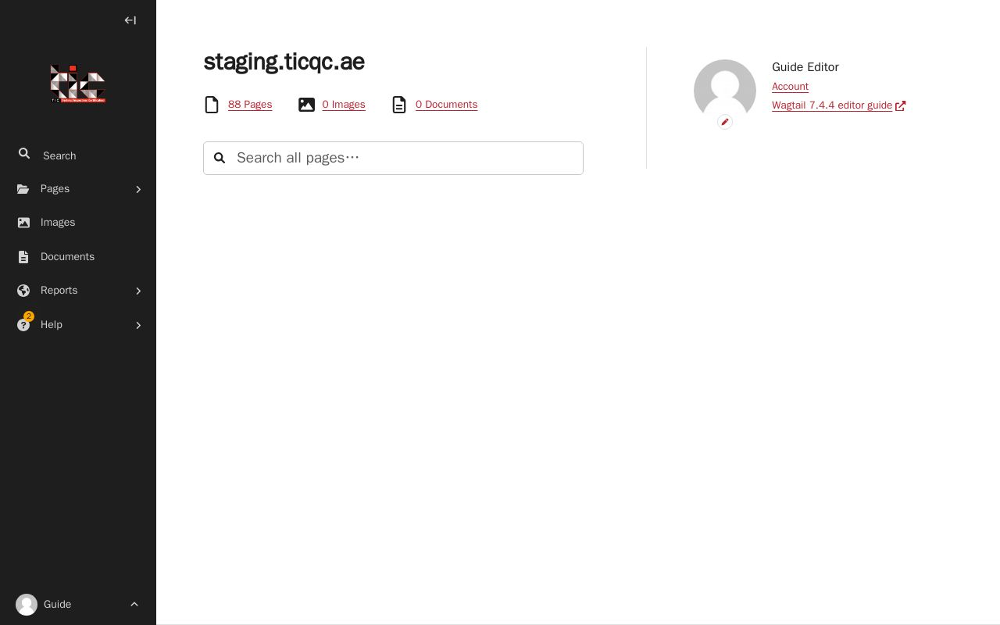

## 2. Edit your office page

1. Click **Pages**, then **Our offices**. Your office is in the list.
2. Click the name of your office. The edit page opens.

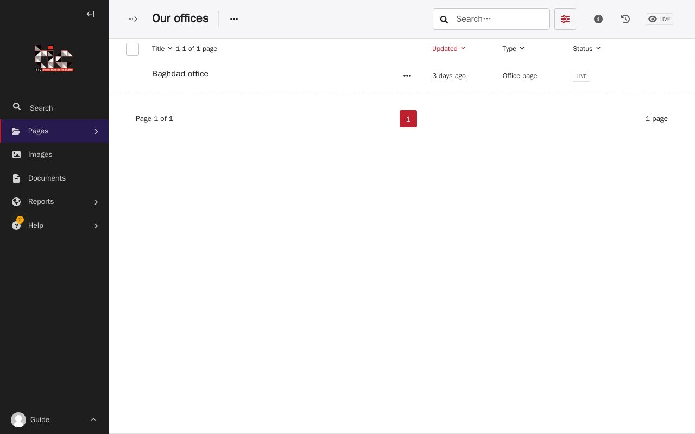

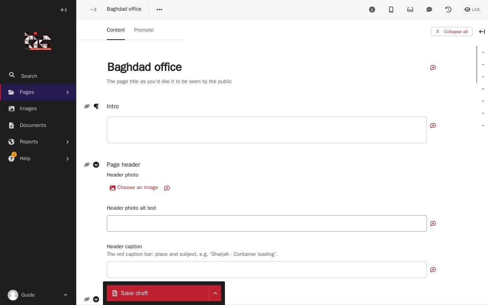

3. Change the text. The grey line under each field tells you what to write.
4. To change the phone, the email or the opening hours, go down to **Reach the office**.
   The phone number is also the office's WhatsApp, except in China.

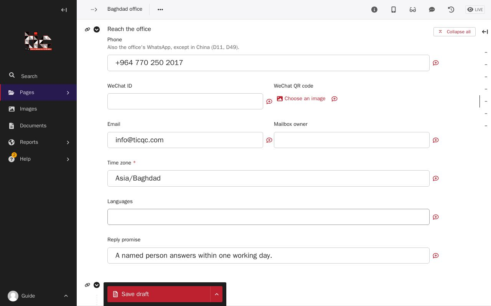

5. To keep your work and stop for now, click **Save draft**. The public page does not
   change.
6. When you are ready, click the arrow next to **Save draft**, then **Submit to Review**.

Your office's reviewer gets the page. When they approve it, the change is on the public
site.

## 3. Write a news item

1. Click **Pages**, then **News and insights**.
2. Click **•••** next to the title, then **Add child page**. The new news page opens.
3. Write the **Title**. Choose the **Kind** (News or Insight) and the **Date**.

4. At **Office**, click **Choose a page (Office page)**. Type the name of your city and
   click your office.

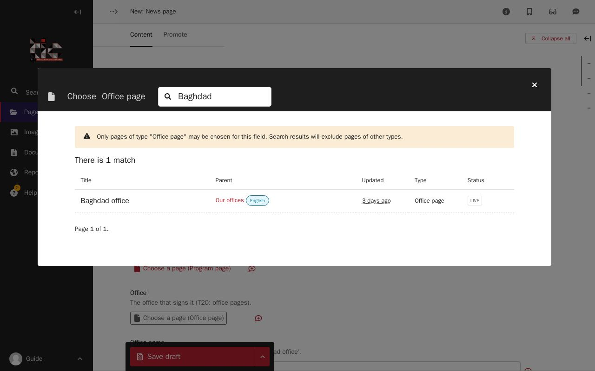

   Always choose your office. If you do not, your office's reviewer does not see the
   news item, and only the head office can publish it.

5. Write the **Standfirst**: one sentence, what changed and from when.

6. Write the **Text**. Use short paragraphs, one idea in each. Use a heading (H2) for each
   new part. Put a link on a document only when the document is in the Documents library.

7. Click the arrow next to **Save draft**, then **Submit to Review**.

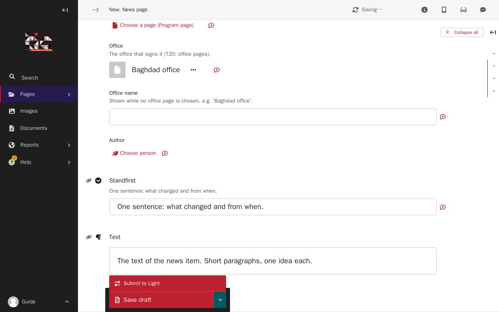

A "Regulatory update" is a news item about a rule of a program. Choose the **Program** for
it too. It then shows on the program page.

## 4. Update a program's product list

Your office edits the programs it owns. For example, the Baghdad office owns the Iraq
Certificate of Conformity.

1. Click **Pages**, then **Government & Trade Programs**, then the program.
2. Go down to **02 Who must comply**. The **product table** has one row for each product
   group: the group, examples, and the standard.
3. To add a row, click the **+** where you want it. To remove a row, click the bin icon.

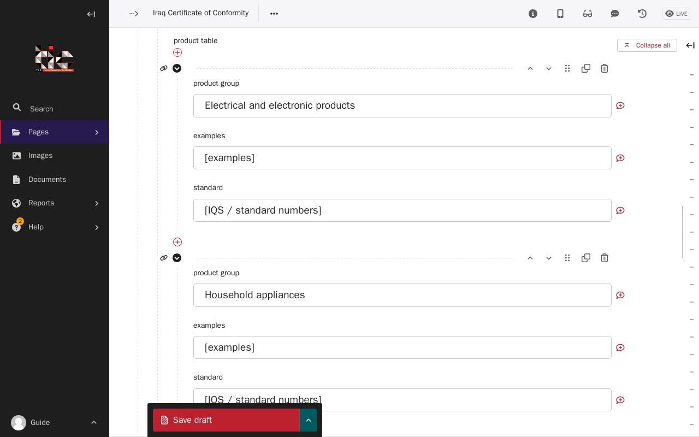

4. Under the table, the **full product list** is the regulator's list as a document.
   Choose the newest one from the Documents library.
5. Set the **version date**: the date of the regulator's list that you show. Without this
   date, the page cannot be submitted.

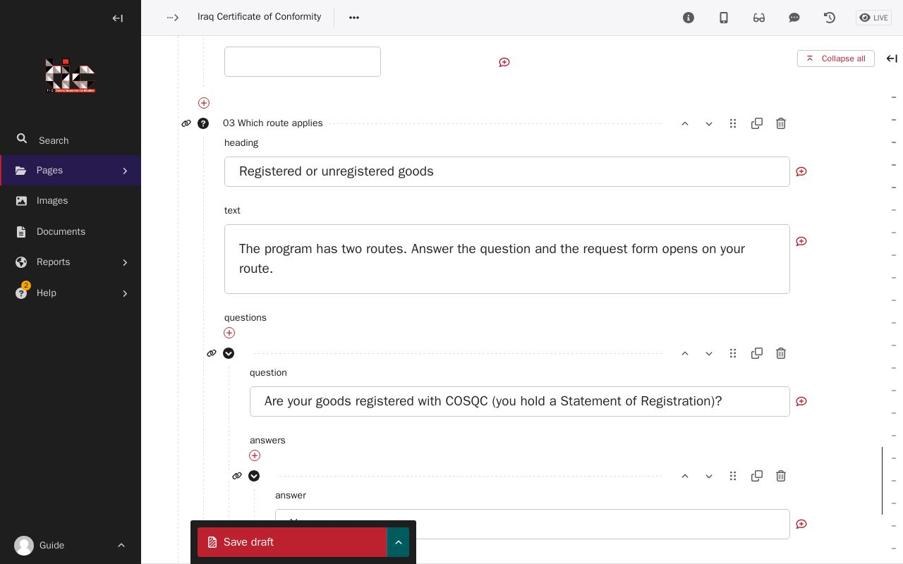

6. Go down to **Ownership and review**. Set **Last reviewed** to today. Set **Review by**
   to the next date when the page must be checked (for example, in three months).

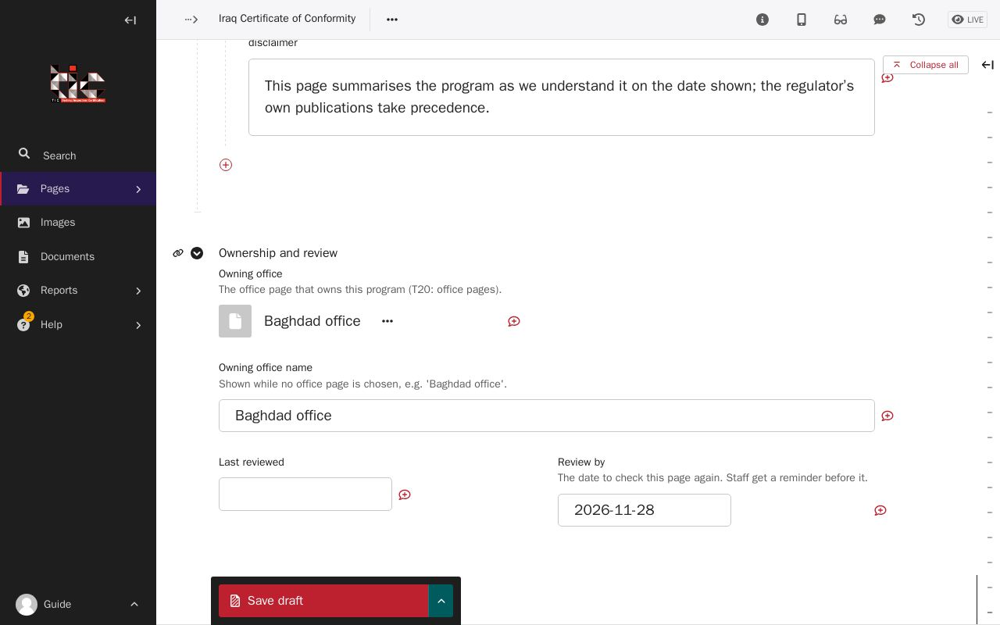

7. Click the arrow next to **Save draft**, then **Submit to Review**.

A program page must have all twelve parts filled before it can be published. If a part
is missing, the admin shows a red message at the top and at the part. The message tells
you what to add, for example:

| Message | What to do |
| --- | --- |
| 02 Who must comply: set the date of the product list shown. | Set the **version date** under the product table. |
| 02 Who must comply: add at least one product group. | Add a row to the product table. |
| 12 Last reviewed: write the disclaimer. | Write the disclaimer in part 12. |
| Last reviewed: set the date. | Set **Last reviewed** under **Ownership and review**. |

"Save draft" always works, also with a missing part. Only "Submit to Review" and
"Publish" check the parts.

Never write "accredited" for a program. A regulator appoints or registers TIC. Use the
regulator's own word.

## 5. The review-by reminder

Two weeks before the **Review by** date of a page, you get an email:

> **Review due: Iraq Certificate of Conformity by 2026-11-28**
>
> This page must be checked again by 2026-11-28: …
> Check the text, update it if needed, and set a new review date: (link)

What to do:

1. Click the last link in the email. The edit page opens.
2. Read the page. Check it against the regulator's newest publications.
3. Correct what changed. If nothing changed, change nothing.
4. Set **Last reviewed** to today and set a new **Review by** date.
5. Click **Submit to Review**.

The email goes to the editors and the reviewers of the office that owns the page. It
comes once for each date. If the date passes, the page shows in **Reports → Pages past
review**. The public site never shows this flag. Keep the report empty.

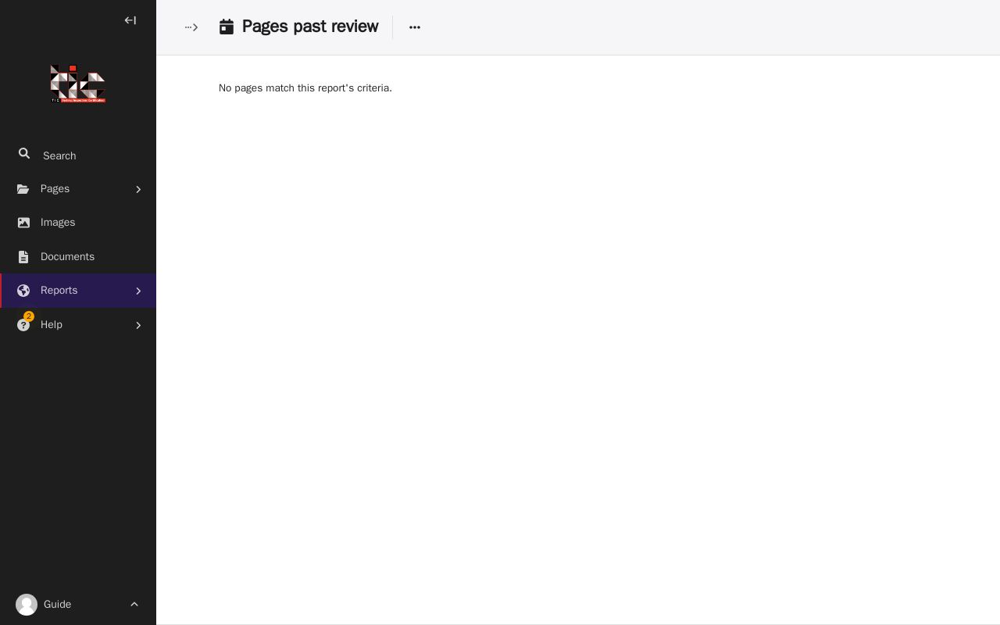

## 6. For reviewers: approve or send back

1. On the dashboard, **Awaiting your review** lists the pages that wait for you.

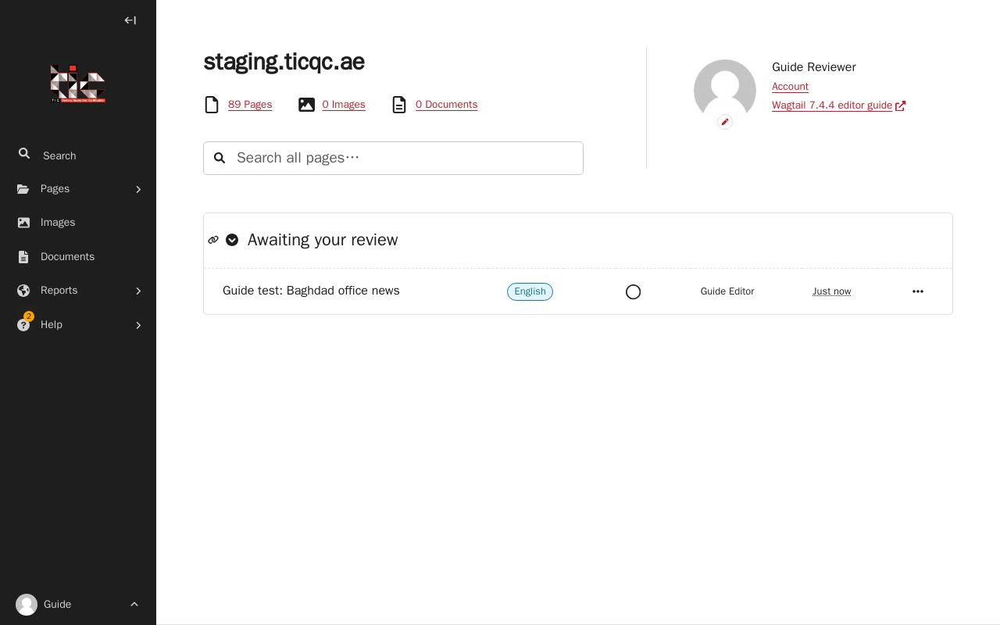

2. Click the page. Read the change. Use the preview icon (top right) to see the page as
   the public will see it.
3. Click the arrow next to **Save draft**. Then choose:
   - **Approve**: the page is published.
   - **Approve with comment**: the same, with a note to the editor.
   - **Request changes**: the page goes back to the editor with your note.

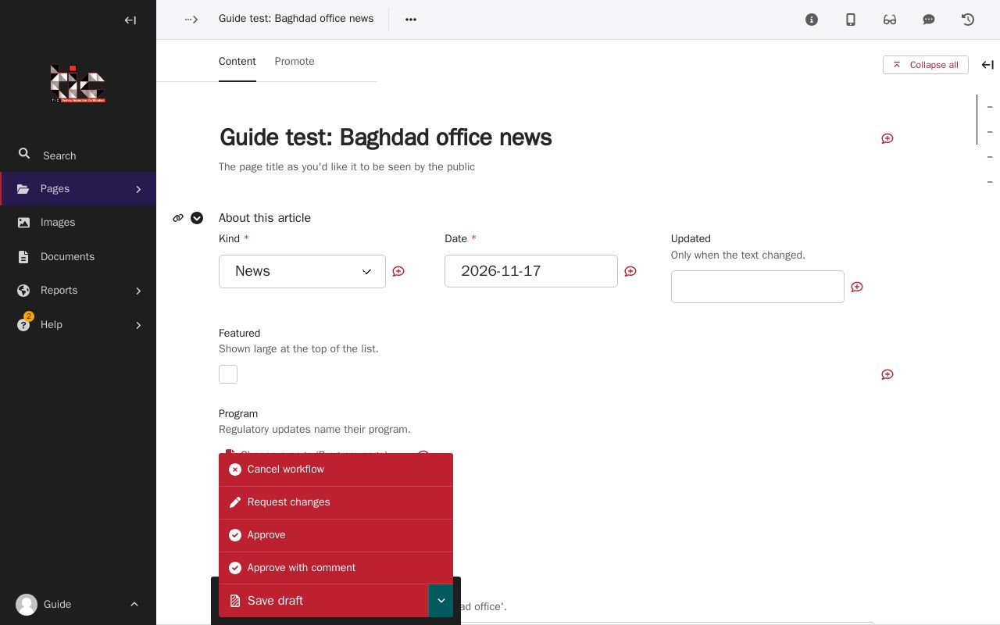

You cannot approve a page that you submitted yourself. If you made a large change, ask
another reviewer or a content manager to approve it.

## 7. Answer a request

A request is a message from the website: a quote request, a complaint, a job
application. Today the site admins answer requests. Office editors will see the requests
of their own office in a later version.

1. Click **Requests** in the menu.

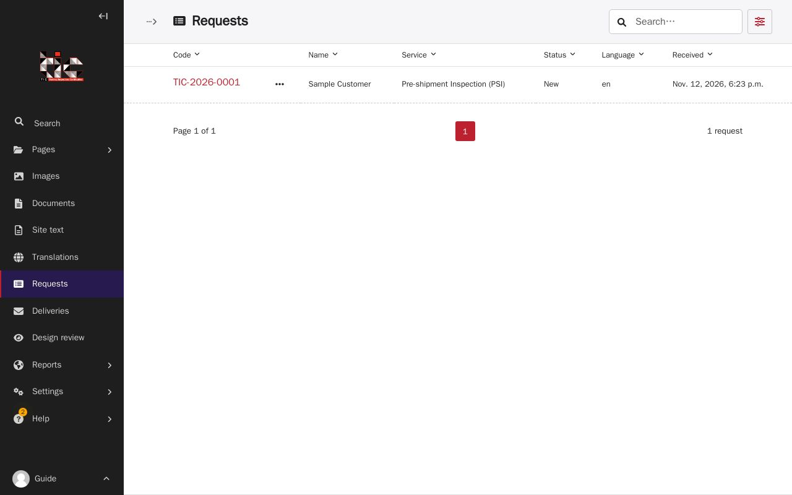

2. Click a request to open it. You see the fields, the files and the history.

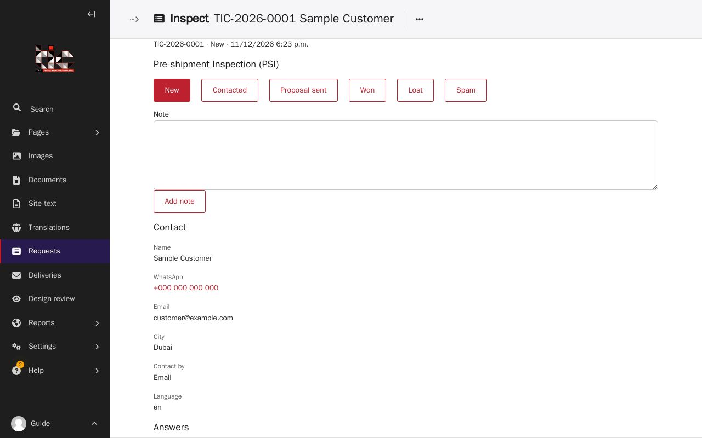

3. Answer the customer by email from your office mailbox.
4. Click the new status: **Contacted**, **Proposal sent**, **Won** or **Lost**. Click
   **Spam** for a message that is not a real request.
5. Write in **Note** what you did and when. Click **Add note**. The history keeps every
   status and every note.

The pictures of this part show a test request with sample name, phone and email.

## Help

- A question about a page or a fact: ask the head office content manager.
- A login problem: ask the site admin.
- The full documentation: `docs/admin-guide/`.
